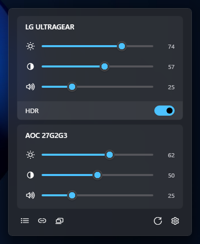
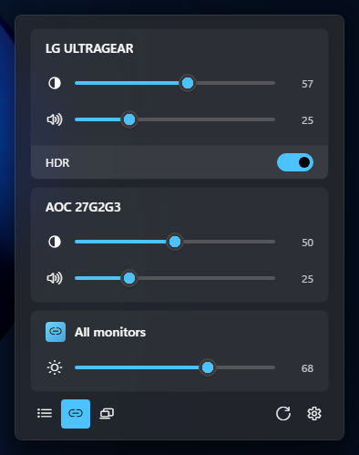
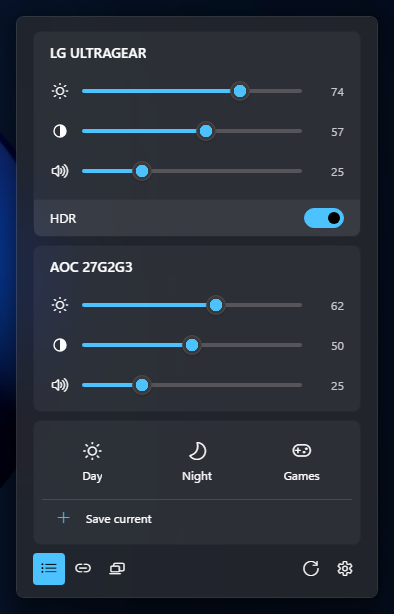
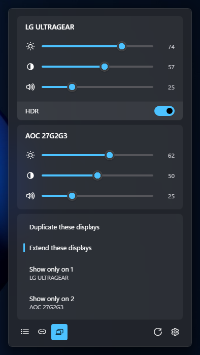
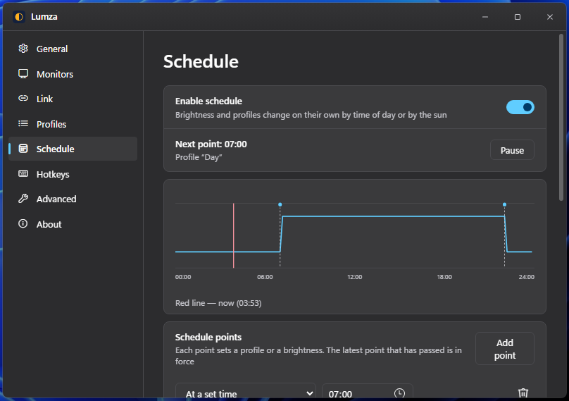
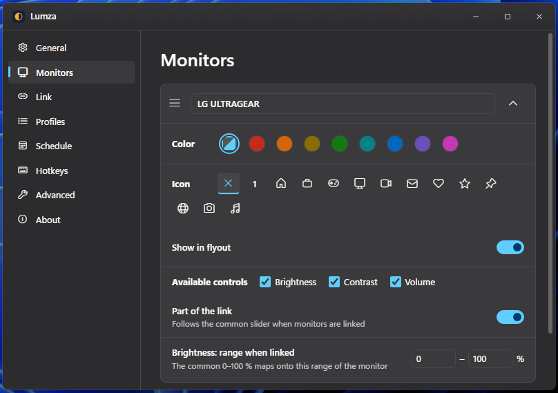

<div align="center">


# Lumza

**Яркость, контрастность и громкость мониторов из трея Windows — одним кликом.**

[](https://github.com/NemoKing1210/Lumza/releases/latest)
[](https://github.com/NemoKing1210/Lumza/releases)
[](#лицензия)


[**Скачать**](https://github.com/NemoKing1210/Lumza/releases/latest) ·
[Возможности](#возможности) ·
[Скриншоты](#скриншоты) ·
[Установка](#установка) ·
[Сборка](#сборка-из-исходников) ·
[Журнал изменений](CHANGELOG.md) ·
[Как помочь проекту](CONTRIBUTING.md)

[English](README.md) · **Русский**

<br>


&nbsp;&nbsp;


</div>

<br>

Lumza — лёгкое open-source приложение для Windows 11 (и 10 21H2+). Оно живёт в трее и управляет внешними мониторами по DDC/CI, так что не нужно крутить кнопки на корпусе. Ядро написано на Rust и работает с железом напрямую через Win32; интерфейс — маленький Svelte-фронтенд в WebView2 (Tauri 2).

## Возможности

| | |
| --- | --- |
| 🎚️ **Flyout из трея** | Ползунки яркости, контрастности и громкости для каждого монитора. Mica, системная тема и акцентный цвет, управление с клавиатуры, колесо мыши над ползунком. |
| 🔗 **Связанные ползунки** | Один общий ползунок на параметр с калибровкой диапазона для каждого монитора (например, LG 0–100, AOC 10–85), чтобы панели разной яркости выглядели одинаково. Любой монитор можно исключить из связки. |
| 🌗 **Профили** | «День», «Ночь», «Игры» из коробки и свои. Профиль может менять только часть параметров. |
| ⏰ **Расписание** | Точки по времени или по восходу и закату (координаты вводите сами — геолокации и сети нет), плавные переходы, пауза при ручном изменении, пропуск при полноэкранном приложении. После сна, разблокировки и подключения монитора применяется значение, актуальное на этот момент. |
| ⌨️ **Горячие клавиши и OSD** | Яркость всех мониторов или одного, громкость, профили, пауза расписания. По умолчанию выключены; после включения предустановлены `Ctrl+Alt+↑/↓` и `Ctrl+Alt+B` (открыть flyout). OSD не забирает фокус. |
| 🖥️ **Режимы дисплеев** | Дублирование, расширение или показ только на одном дисплее (как в Win+P) — из flyout или из меню в трее. |
| ✨ **Переключатель HDR** | HDR для каждого монитора в flyout; показывается только у дисплеев, которые его поддерживают. |
| 🎨 **Значки мониторов** | Цвет и иконка для каждого монитора, чтобы их различать; переименование, порядок и скрытие мониторов. |
| 🌍 **Семь языков** | English, Русский, Español, Deutsch, Français, Português, 简体中文. Строки лежат во внешних JSON (`locales/`). |

**Аккуратно с железом.** Запись не чаще раза в 100 мс при перетаскивании, в очереди монитора хранится только последнее значение, шаги плавного перехода не чаще раза в 30 с. Каждый монитор опрашивается в своём потоке, медленный монитор не тормозит остальные и интерфейс.

**Приватно и ненавязчиво.** Никакой телеметрии. Единственный сетевой запрос — проверка обновлений на GitHub при запуске; отключается в «Настройки → О программе». Работает **без прав администратора**.

## Скриншоты

<table>
  <tr>
    <td align="center" width="50%">
      <br>
      <sub><b>Профили</b> — вся конфигурация одним нажатием</sub>
    </td>
    <td align="center" width="50%">
      <br>
      <sub><b>Режимы дисплеев</b> — дублирование, расширение или один дисплей</sub>
    </td>
  </tr>
</table>

<p align="center">
  <br>
  <sub><b>Расписание</b> — 24-часовой график того, что будут делать мониторы</sub>
</p>

<p align="center">
  <br>
  <sub><b>Мониторы</b> — цвет, иконка, видимость, доступные регуляторы и диапазон калибровки</sub>
</p>

> Скриншоты сделаны на встроенных эмулируемых мониторах (`LUMZA_MOCK=1`) и на английском интерфейсе — реального оборудования на них нет.

## Установка

Скачайте со страницы [Releases](https://github.com/NemoKing1210/Lumza/releases/latest):

| Файл | Что это |
| --- | --- |
| `Lumza_<версия>_x64-setup.exe` | установщик для Windows на x64 (на пользователя, без прав администратора) |
| `Lumza_<версия>_arm64-setup.exe` | установщик для Windows на ARM64 |
| `Lumza-portable-x64.zip` / `-arm64.zip` | portable-версия: настройки хранятся рядом с программой, автозапуск не включается |

Нужен [WebView2 Runtime](https://developer.microsoft.com/microsoft-edge/webview2/): в Windows 11 он уже есть, установщик скачает его сам, если его нет.

> [!NOTE]
> Пока приложение не подписано сертификатом, SmartScreen может показать предупреждение — нажмите «Подробнее → Выполнить в любом случае». Обновления внутри приложения проверяются подписью ключа проекта.

Удаление: «Параметры → Приложения». В деинсталляторе можно отметить удаление настроек, кэша и журналов; запись автозапуска удаляется всегда.

## Использование

- **Левый клик** по значку в трее открывает flyout, `Esc` или клик в сторону закрывает его. **Правый клик** — меню: обновить мониторы, профили, режим дисплеев, пауза расписания, настройки, выход.
- Кнопки внизу flyout открывают **профили**, **общие (связанные) ползунки** и **режимы дисплеев**; шестерёнка — настройки.
- Если запустить Lumza второй раз, откроется flyout уже работающей копии.

> [!TIP]
> Если монитор не отвечает, включите **DDC/CI** в его экранном меню (OSD). Через некоторые док-станции, USB-C хабы, DisplayLink и KVM DDC/CI не проходит. При включённом HDR часть мониторов блокирует яркость.

> [!WARNING]
> Не запускайте Lumza вместе с Twinkle Tray или Monitorian: две программы, пишущие по DDC/CI одновременно, мешают друг другу.

## Проверенные мониторы

| Монитор | Подключение | Яркость | Контраст | Громкость | MCCS |
| --- | --- | :---: | :---: | :---: | --- |
| LG ULTRAGEAR (GP850) | DisplayPort | ✅ | ✅ | ✅* | 2.1 |
| AOC 27G2G3 | DisplayPort / HDMI | ✅ | ✅ | ✅* | 2.2 |

\* Параметр доступен, но у этих моделей нет встроенных динамиков, поэтому звук не меняется.

Проверили вашу модель? Расскажите об этом в [issue](https://github.com/NemoKing1210/Lumza/issues/new/choose): модель, тип подключения, что работает.

<details>
<summary><b>Измеренные показатели</b></summary>

<br>

Установленная копия на Windows 11, два монитора:

| Показатель | Цель | Результат |
| --- | --- | --- |
| Установщик (NSIS) | ≤ 10 МБ | 2,55 МБ |
| ОЗУ в простое, сумма процессов с WebView2 (приватный рабочий набор, как в Диспетчере задач) | ≤ 80 МБ | 59,7 МБ |
| CPU в простое, 10 минут | ≈ 0 % | 0,07 % одного ядра (0,41 с за 10 минут) |
| Значок в трее после запуска процесса | < 1 с | 0,19 с |
| Открытие flyout (окно создаётся заранее) | < 150 мс | 14–33 мс |
| Первое чтение значений мониторов | < 2 с (3 монитора) | 0,42 с (2 монитора) |

</details>

<details>
<summary><b>Где Lumza хранит данные</b></summary>

<br>

| Что | Где |
| --- | --- |
| Настройки | `%APPDATA%\Lumza\settings.json` (с `schemaVersion`; повреждённый файл переименовывается в `settings.broken-<время>.json`) |
| Кэш последних значений | `%LOCALAPPDATA%\Lumza\cache.json` |
| Журнал (5 × 1 МБ) | `%LOCALAPPDATA%\Lumza\logs\` |

</details>

## Сборка из исходников

Нужны [Rust](https://rustup.rs) (stable), [Node.js](https://nodejs.org) 22+ и Windows 10/11 с WebView2.

```bash
npm ci && npm --prefix ui ci
npm run tauri dev            # запуск в режиме разработки
npm run tauri build          # установщик в target/release/bundle/nsis
```

Без монитора и железа можно работать на эмуляторе: `LUMZA_MOCK=1`. Консольная утилита для диагностики DDC/CI: `cargo run -p lumza-cli -- list` (`get`, `set`, `caps`).

Проверки, как в CI: `cargo fmt --all --check`, `cargo clippy --workspace --all-targets -- -D warnings`, `cargo test --workspace`; в `ui/` — `npm run lint`, `npm run typecheck`, `npm test`. Подробнее — в [CONTRIBUTING.md](CONTRIBUTING.md).

## Пока нет

Выбор источника сигнала, mute, выключение экрана по DDC (P2), программное затемнение для мониторов без DDC/CI, автопрофиль по запуску процесса, регулировка яркости колесом над значком в трее. Подробности и планы — в [issues](https://github.com/NemoKing1210/Lumza/issues).

## Лицензия

Двойная лицензия: [MIT](LICENSE-MIT) или [Apache-2.0](LICENSE-APACHE) — на ваш выбор.
